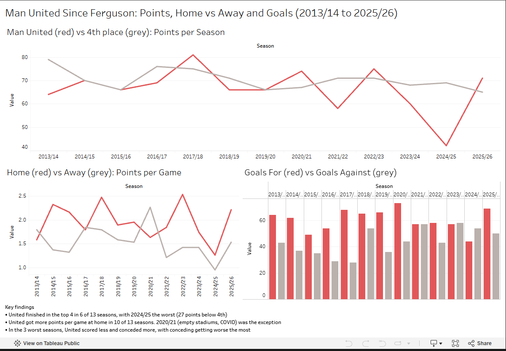

# Man United Since Ferguson

Analysis of Man United's Premier League results from 2013/14 (the first season after Sir Alex Ferguson retired) to 2025/26.

**[View the dashboard on Tableau Public](https://public.tableau.com/app/profile/angelo.howe.de.leon/viz/ManUnitedSinceFerguson/ManUnitedDashboard)**

## Questions

1. How have United done against the top 4 since Ferguson?
2. How much better are United at home than away?
3. Are United scoring less or conceding more?

## Key findings

**1. Points vs 4th place**

| Season | United | 4th place | Gap |
|---|---|---|---|
| 2017/18 (best) | 81 | 75 | +6 |
| 2015/16 (closest miss) | 66 | 66 | 0 (lost on goal difference) |
| 2024/25 (worst) | 42 | 69 | -27 |

United finished in the top 4 in 6 of 13 seasons.

**2. Home vs away**

- United got more points per game at home in 10 of 13 seasons
- Biggest gap was 2022/23: 2.53 at home vs 1.42 away
- 2024/25 was the worst away season, under 1 point per game
- 2020/21 was the exception (better away), the season played in empty stadiums during COVID

**3. Goals**

| | Top 4 seasons | Worst 3 seasons |
|---|---|---|
| Scored | 58 to 73 | 44 to 57 |
| Conceded | 28 to 50 | 54 to 58 |

Both got worse in the bad seasons, but conceding went up more than scoring went down.

## How I did it

1. Loaded 13 seasons of match results straight from football-data.co.uk with pandas
2. Split each match into a home row and an away row, so every team has one row per game
3. Worked out points (3 for a win, 1 for a draw) and built a league table for every season
4. Compared United to 4th place, home vs away, and goals for vs against
5. Saved one summary CSV and built the dashboard in Tableau Public

## Tools

- **Python (pandas)** for loading, cleaning and analysis
- **Jupyter Notebook** in VS Code
- **Tableau Public** for the dashboard

## Data

Premier League match results from [football-data.co.uk](https://www.football-data.co.uk), 4,940 matches across 13 seasons.

League positions are worked out from points, goal difference and goals scored. Any points deductions are not included.

## Files

| File | What it is |
|---|---|
| `epl_analysis.ipynb` | Analysis notebook |
| `data/epl_matches.csv` | All match results |
| `data/united_seasons.csv` | United's season summary used for Tableau |
| `images/dashboard.png` | Dashboard screenshot |

## Author

Angelo Howe De Leon, Diploma in Information Technology (Full Stack Development), Republic Polytechnic